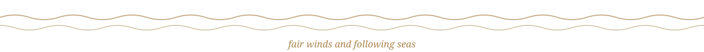

  
  
  

  
  
  

## ⚓ Captain's log

I sail between two seas: **actuarial science** and **data science**.

- 🎓 Double degree: **Master's in Actuarial Science** (IRA, Le Mans University) and **Engineering Degree in Data Science** (ESPRIT)
- 🧭 Last port: **Vermeg**, where I built a GenAI copilot that configures retirement-savings products in **Solife**, plus a hybrid RAG assistant over an insurance corpus
- 📈 I like models you can explain to a regulator: GLM pricing, mortality projection, reserving, and ML that stays auditable
- 🏆 Hackathons: **1st place** at lablab.ai Special AI Models Hack and **2nd place** at ChatHack

## 🗺️ The two seas

<table>
  <tr>
    <th align="left" width="50%">🐚 Actuarial</th>
    <th align="left" width="50%">🌊 Data science</th>
  </tr>
  <tr valign="top">
    <td>
      Non-life pricing (Poisson / Gamma GLM) 
      Mortality modelling (Lee-Carter) 
      Annuity pricing, risk theory 
      Reserving (Chain Ladder, Mack, Bootstrap) 
      ALM, Solvency II, IFRS 17
    </td>
    <td>
      LLMs, RAG, retrieval evaluation 
      NLP and information extraction 
      Computer vision (YOLO, OCR) 
      Forecasting and classification 
      FastAPI, Docker, Kafka, MLOps
    </td>
  </tr>
</table>

## 📜 Scrolls from the voyage

| | Project | What it does |
|---|---|---|
| 🚗 | **Motor insurance pricing** | Poisson frequency and Gamma severity GLMs on freMTPL2 (678k policies), turned into pure premiums and a tariff matrix by zone and driver age. *R* |
| ⏳ | **Portfolio heterogeneity study** | Lee-Carter mortality of French smokers and non-smokers, projected trends and fair annuity pricing per group. *R* |
| 🩺 | **AI platform for medical insurance documents** | Handwritten Arabic/French claims: YOLO classification, fine-tuned OCR, signature fraud detection (Siamese network), RAG chatbot, Kafka microservices. |
| 📉 | [**Customer-Churn**](https://github.com/YassineBenMaktouf/Customer-Churn) | Telecom churn with Random Forest and Decision Tree on SMOTE-balanced data, PCA and K-Means for churn drivers, served behind a REST API. |
| 🥇 | [**Imaginify-AI**](https://github.com/YassineBenMaktouf/Imaginify-AI) | 1st place, Special AI Models Hack. Interactive stories with generated illustrations, speech-to-text and text-to-speech. |
| 🥈 | [**FinAssist**](https://github.com/YassineBenMaktouf/ChatHack-EchoMinds) | 2nd place, ChatHack. Personal-finance app that reads Excel data, charts it and answers questions through a chatbot. |
| 🗣️ | [**LinguaSync-AI**](https://github.com/YassineBenMaktouf/LinguaSync-AI) | Language-learning app that generates exercises with GPT-4, with a chatbot tutor, evaluated with TruLens. |
| 🧭 | [**Portfolio**](https://github.com/YassineBenMaktouf/Portfolio) | This voyage as a website: a parchment sea chart with five islands, built with plain JS and GSAP. |

## 🧰 In the hold

   
  

Also on deck: Hugging Face Transformers, LangChain, MLflow, SQL Server, Excel, Solife.

